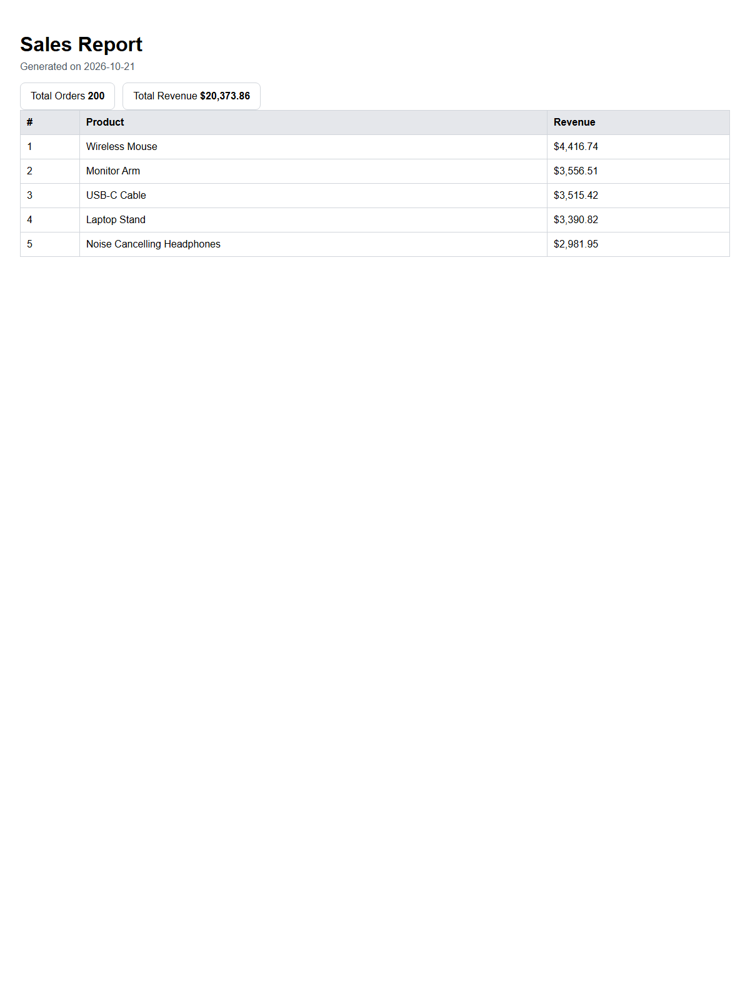

# PDF Report Generator

This project builds a small report pipeline from raw data to a real PDF file. It uses SQLite for data storage, a single SQL aggregation query to turn rows into numbers, Playwright to render an HTML page into a PDF, and an Express API to generate and serve the final artifact by link.

## Dataset chosen

I used the shop dataset option. The app seeds a SQLite database named `report.db` with 200 generated orders in the `orders` table.

## Run it locally

```bash
npm install
npm run seed
npm start
```

Then hit the endpoints:

```bash
curl -i http://localhost:3000/health
curl -i -X POST http://localhost:3000/reports
curl -o report.pdf http://localhost:3000/reports/1/file
```

## Aggregation SQL

```sql
SELECT
  COUNT(*) AS totalOrders,
  COALESCE(SUM(amount), 0) AS totalRevenue
FROM orders;

SELECT product, SUM(amount) AS revenue
FROM orders
GROUP BY product
ORDER BY revenue DESC, product ASC
LIMIT 5;

SELECT DATE(created_at) AS date, COUNT(*) AS orderCount
FROM orders
WHERE created_at >= date('now', '-6 days')
GROUP BY DATE(created_at)
ORDER BY date ASC;
```

## POST -> download proof

```bash
curl -i -X POST http://localhost:3000/reports
```

Example response:

```json
{"id":1,"file":"/reports/1/file"}
```

Then download the served artifact:

```bash
curl -o my-report.pdf http://localhost:3000/reports/1/file
```

The file is a real PDF and can be opened in any PDF viewer.

## Stage 4 sentence

I would move this work out of the request once generating the PDF starts to noticeably slow the endpoint for users, or when a report may be generated in bulk and you need to keep the API responsive while the work completes in the background.

## Stage 5 sentence

This check protects against duplicate clicks on the Generate Report button creating the same report twice and sending a customer the same document more than once. In an e-commerce flow, a missed dedupe check can cause duplicate refund emails or repeated invoice notifications that cost real money.

## Screenshot (page 1)



## Notes

- `report.db` is created by the seed script and kept out of version control.
- Generated PDFs live in the `reports/` directory and are also gitignored.
- The app enforces idempotency for same-day duplicate requests; `force: true` creates a fresh report anyway.
